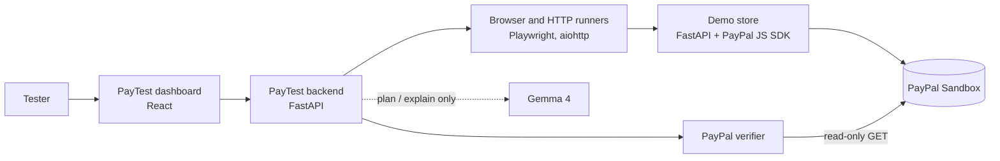

# PayTest AI

**An AI-assisted testing agent that checks e-commerce checkouts and PayPal payments, and backs every verdict with evidence.**

Built for the PayPal AI Hackathon on top of TestPilot AI, an open-source website and API testing tool.

A store's "Payment complete" page can be wrong. A browser test can pass while the money was never collected, and an AI can say a payment worked when it didn't. PayTest checks each claim against something it can trust: real browser and HTTP runners, and **PayPal's own record of the order**. The AI plans tests and explains results, but it never decides a result.


---

## What it does

| Area | What PayTest checks |
|---|---|
| **PayPal payments** | Reads the order straight from the PayPal Sandbox Orders API: does it exist, is it `COMPLETED`, was it **captured**, and do the order and capture amounts match what the store should have charged? |
| **Website** | HTTP status, title, headings, console errors, links, security headers, cookies, exposed files, accessibility (axe-core), keyboard focus, response time, scripted user flows (fill, click, expect text), and screenshots on failure |
| **API** | Status, response time, content type, redirects, size, JSON assertions, JSON Schema, response shape, and OpenAPI contract tests (Schemathesis) |
| **AI (Gemma 4)** | Turns a plain-English goal into a test plan you review before it runs, and explains a finished report. It never changes a result. |
| **History** | Saved runs, side-by-side comparison (fixed / regressed), and self-contained HTML reports |

### Catching payment bugs

The included demo store has two **controlled defects** you can switch on to show PayTest catching real payment bugs:

| Defect | The bug | What PayTest reports |
|---|---|---|
| `trust_client_price` | The server uses the price the browser sends, so the buyer can tamper with the amount | **Amount and currency: failed**. PayPal charged less than the catalog total. |
| `confirm_without_capture` | The store shows "Payment complete" without capturing the money | The store says `PAID`, but PayPal says `APPROVED` with no capture: **Payment captured: failed** |

---

## How it works



1. A buyer pays in the **demo store** with a PayPal Sandbox account. The store prices the cart on its server, creates the PayPal order, and captures it after approval.
2. The store records what it **believes** happened (`GET /api/orders/{id}`).
3. PayTest asks **PayPal** what actually happened (`POST /api/paypal/verify`) and compares the two, check by check, with evidence.

### Design principles

- **Evidence decides, AI advises.** Runners and PayPal's API produce every status; Gemma's output is labelled advisory.
- **Sandbox only.** The PayPal API address is hard-coded to `api-m.sandbox.paypal.com`. No setting can point PayTest at live payments.
- **Read-only.** The verifier only reads orders. Browser runs allow GET/HEAD requests only, and the API runner sends a single GET.
- **No personal data in evidence.** Payer and payee details are never copied into results.
- **SSRF-safe.** Every target address is validated and the connection pinned to it, and the browser cannot open connections of its own. See [docs/threat-model.md](docs/threat-model.md).

---

## Quick start (local)

**Requirements:** Python 3.12+, Node.js 22+, and a free [PayPal Developer](https://developer.paypal.com) account.

### 1. Install

```bash
cd backend
python -m venv .venv
.venv\Scripts\pip install -r requirements-dev.txt
.venv\Scripts\python -m playwright install chromium
.venv\Scripts\pip install -r ..\demo-store\requirements.txt
cd ..\frontend
npm ci
```

On macOS or Linux, use `.venv/bin/` instead of `.venv\Scripts\`.

### 2. Add PayPal Sandbox keys

Copy `backend/.env.example` to `backend/.env`, and `demo-store/.env.example` to `demo-store/.env`, then fill in your Sandbox **Client ID** and **Secret**. Full steps, including a fix for developer accounts registered in India, are in [docs/paypal-sandbox.md](docs/paypal-sandbox.md).

Optionally, set `TESTPILOT_GOOGLE_API_KEY` in `backend/.env` to turn on Gemma. Everything else works without it.

### 3. Run (three terminals)

```bash
cd backend; .\.venv\Scripts\python -m uvicorn app.main:app --port 8000
```

```bash
cd demo-store; ..\backend\.venv\Scripts\python -m uvicorn store_app:app --port 8100
```

```bash
cd frontend; npm run dev
```

| Open | What |
|---|---|
| http://127.0.0.1:5173 | PayTest dashboard |
| http://127.0.0.1:8100 | Demo store |
| http://127.0.0.1:8000/docs | Backend API docs |

### 4. Try it

1. In the **demo store**, click **PayPal** and pay with your Sandbox *Personal* (buyer) account.
2. Copy the **Order** id the store shows.
3. In the **dashboard**, go to **PayPal checks**, paste the id, choose **Paid and captured**, enter `18.00`, and click **Verify with PayPal**.
4. All four checks should pass. Then switch on a defect, pay again, and watch PayTest catch it.

---

## Project layout

```
backend/      FastAPI API: runners, PayPal verifier, Gemma adapter, storage, security
frontend/     React dashboard (Vite)
demo-store/   PayPal Sandbox checkout used as the test target, with switchable defects
demo-site/    Static pages published to GitHub Pages as a public website-test target
docs/         Setup, API contract, deployment, threat model and design decisions
scripts/      Local start and validation helpers
```

## Tests

```bash
cd backend; .\.venv\Scripts\python -m unittest discover -s tests
```

```bash
cd demo-store; ..\backend\.venv\Scripts\python -m unittest discover -s tests
```

```bash
cd frontend; npm run lint; npm test
```

GitHub Actions runs the backend, demo-store and frontend tests and a Docker build on every push.

## Deployment

The PayTest backend and dashboard ship as a single Docker image (`docker compose up --build`). A Render blueprint (`render.yaml`) is included. Public deployments refuse to start unless authentication, rate limiting, audit logging and HTTPS are configured. See [docs/deployment.md](docs/deployment.md).

## Roadmap

- [x] PayPal Sandbox checkout in a controlled demo store
- [x] Independent payment verification against the PayPal Orders API
- [x] Controlled defects: amount tampering and confirmation without capture
- [x] Dashboard panel for payment verification
- [ ] Playwright checkout scenarios (success and cancellation) driven from the dashboard
- [ ] Gemma explanations that link payment evidence to browser evidence
- [ ] Webhook signature verification check
- [ ] Hosted demo (Render) and remote browser sessions (Kernel)

## Documentation

- [PayPal Sandbox setup](docs/paypal-sandbox.md)
- [API contract](docs/api-contract.md)
- [Deployment](docs/deployment.md)
- [Threat model](docs/threat-model.md)
- [Design decisions](docs/decisions.md)

## License

[MIT](LICENSE). The vendored axe-core is MPL-2.0 (`backend/app/vendor/`).
