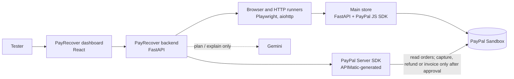

# PayRecover AI

**An AI agent for PayPal merchants: it finds money a store has lost, proves each leak, and shows how to get it back.**

Built for the PayPal AI Hackathon on top of TestPilot AI, an open-source website and API testing tool (this project was called PayTest AI until October 2026).

A store's "Payment complete" page can be wrong. The store can say an order is paid while PayPal never captured the money, charge less than the catalog price, or charge one cart twice. PayRecover checks each claim against something it can trust: **PayPal's own record of the order**, read through PayPal's official Server SDK, plus real browser and HTTP runners. Gemini explains every result in plain words, but it never decides a result.


---

## What it does

| Area | What PayRecover checks |
|---|---|
| **PayPal payments** | Reads the order straight from the PayPal Sandbox Orders API: does it exist, is it `COMPLETED`, was it **captured**, and do the order and capture amounts match what the store should have charged? |
| **Website** | HTTP status, title, headings, console errors, links, security headers, cookies, exposed files, accessibility (axe-core), keyboard focus, response time, scripted user flows (fill, click, expect text), and screenshots on failure |
| **API** | Status, response time, content type, redirects, size, JSON assertions, JSON Schema, response shape, and OpenAPI contract tests (Schemathesis) |
| **AI (Gemini)** | Turns a plain-English goal into a test plan you review before it runs, and explains a finished report or order investigation in plain words. It never changes a result. |
| **History** | Saved runs, side-by-side comparison (fixed / regressed), and self-contained HTML reports |

### The Main store

`main-store/` is the PayPal Sandbox checkout PayRecover checks, built to pass every check: it prices carts on
the server and ignores any price the browser sends, marks an order paid only after PayPal captures it,
sends a strict Content-Security-Policy and the other security headers, documents every response code in
its OpenAPI schema, saves orders so they survive a restart, and lets each cart be paid only once.

### The Vulnerable store

`vuln-store/` (port 8200) is a deliberately broken copy for demos, kept apart so the Main store stays clean.
Tick the bugs to simulate on its page, pay, and investigate the order in PayRecover with **Store: Vulnerable**:

| Bug on the page | What PayRecover reports |
|---|---|
| Charge the price the browser sends (prices are editable) | **Wrong amount** leak, and the price-tampering probe fails |
| Show "paid" without capturing at PayPal | **Fake paid** or **Never captured** leak |
| Let the same cart be paid multiple times | **Duplicate charge** leak, naming the other order to refund |
| Always on: search box echoes `?q=` unescaped, no security headers | **XSS found**, and the security-headers check fails |

### Scan my store

One click checks every recent order the store calls paid (up to 50) against PayPal. Leaks are ranked by
urgency, then amount: an approved payment still uncollected comes first, with a live *waiting since* clock
taken from PayPal's own timestamp (PayPal does not publish a fixed deadline for capturing an approved order,
so PayRecover shows how long it has waited rather than inventing a countdown). Gemini writes the recovery plan
for that fixed order; it cannot add, drop or reorder leaks. A cart charged twice yields one refund, of the
later charge, so approving every row never refunds the whole purchase.

### Dispute-ready evidence pack

Every investigation and scan row has an **Evidence pack**: a printable page, generated from a fresh read of
the store and PayPal, with both records side by side, every check, the leaks, every recovery and its PayPal
references, and a SHA-256 fingerprint of that evidence. Print it to PDF and attach it to a PayPal dispute or
chargeback.

### Built on PayPal's Server SDK (APIMatic)

PayRecover reads orders, captures missed payments and refunds duplicate charges through
[PayPal's official Python Server SDK](https://github.com/paypal/PayPal-Python-Server-SDK) (`paypal-server-sdk`),
which PayPal generates with [APIMatic](https://www.apimatic.io/). The SDK is locked to Sandbox in
`backend/app/paypal_sdk.py` and returns PayPal's JSON unchanged, so every check works on PayPal's own record.
Invoicing is not part of the SDK yet, so invoices still use PayPal's Invoicing REST API directly.

### Recovering the money

Every leak comes with a recovery the merchant can approve, on the dashboard or from a Zapier message:

| Leak | Recovery at PayPal (Sandbox) | Confirmed when |
|---|---|---|
| Never captured | Capture the approved order | PayPal shows a COMPLETED capture for the full amount |
| Wrong amount, fake paid | Send the buyer a PayPal invoice for the missing amount | PayPal shows the invoice SENT for that amount |
| Duplicate charge | Refund the extra capture | PayPal shows the refund COMPLETED or PENDING |

The **Money recovered** panel (AG Grid) lists every recovery with totals collected, invoiced and refunded.
Invoicing needs the *Invoicing* feature switched on for your Sandbox app (Apps & Credentials > your app > Features).

### Zapier: approve from your phone

Set `TESTPILOT_ZAPIER_WEBHOOK_URL` (a Zapier *Catch Hook*) and `TESTPILOT_APPROVAL_SECRET` (32+ random characters)
in `backend/.env`. PayRecover then posts a `leak_found` event for every leak, with a signed **Approve recovery** link
that expires after 24 hours, and a `recovery_done` event after each recovery. In Zapier, forward `leak_found` by
email, Slack or SMS, and append `recovery_done` to a Google Sheet as an audit log. Opening a link only shows a
confirmation page; money moves when the button on it is pressed.

### Catching payment bugs

For every order, PayRecover compares the store's claim with PayPal's record and reports these leaks:

| Leak | What PayRecover sees |
|---|---|
| Never captured | The store says `PAID`; PayPal says `APPROVED` with no capture |
| Fake paid | The store says `PAID`; PayPal never received a payment |
| Wrong amount | PayPal charged less than the catalog total (the server trusted a browser price) |
| Duplicate charge | Another order for the same cart was also captured (or one order captured twice) |

---

## How it works



1. A buyer pays in the **Main store** with a PayPal Sandbox account. The store prices the cart on its server, creates the PayPal order, and captures it after approval.
2. The store records what it **believes** happened (`GET /api/orders/{id}`).
3. PayRecover asks **PayPal** what actually happened (`POST /api/paypal/verify`) and compares the two, check by check, with evidence.

### Design principles

- **Evidence decides, AI advises.** Runners and PayPal's API produce every status; Gemini's output is labelled advisory, with the model that wrote it.
- **Sandbox only.** The PayPal API address is hard-coded to `api-m.sandbox.paypal.com`. No setting can point PayRecover at live payments.
- **Nothing moves without approval.** Investigating only reads PayPal. A capture, refund or invoice runs only when the merchant approves it, is recalculated from PayPal at that moment, runs once (PayPal-Request-Id), and counts only when a fresh read of PayPal confirms it. Browser runs allow GET/HEAD requests only.
- **No personal data in evidence.** Payer and payee details are never copied into results.
- **SSRF-safe.** Every target address is validated and the connection pinned to it, and the browser cannot open connections of its own. See [docs/threat-model.md](docs/threat-model.md).

---

## Quick start (local)

**Requirements:** Python 3.12+, Node.js 22+, and a free [PayPal Developer](https://developer.paypal.com) account.

### 1. Install

```bash
cd backend
python -m venv .venv
.venv\Scripts\pip install -r requirements-dev.txt
.venv\Scripts\python -m playwright install chromium
.venv\Scripts\pip install -r ..\main-store\requirements.txt
.venv\Scripts\pip install -r ..\vuln-store\requirements.txt
cd ..\frontend
npm ci
```

On macOS or Linux, use `.venv/bin/` instead of `.venv\Scripts\`.

### 2. Add PayPal Sandbox keys

Copy `backend/.env.example` to `backend/.env`, and `main-store/.env.example` to `main-store/.env`, then fill in your Sandbox **Client ID** and **Secret**. Full steps, including a fix for developer accounts registered in India, are in [docs/paypal-sandbox.md](docs/paypal-sandbox.md).

Optionally, set `TESTPILOT_GOOGLE_API_KEY` (from [Google AI Studio](https://aistudio.google.com)) and `TESTPILOT_AI_MODEL` (default `gemini-3.8-flash`) in `backend/.env` to turn on Gemini. `TESTPILOT_AI_FALLBACK_MODELS` lists backup models (lighter Flash-Lite models work well) tried when the main one is busy. Everything else works without it.

The Vulnerable store reuses `main-store/.env`, so it needs no keys of its own.

### 3. Run (four terminals; the Vulnerable store is optional)

```bash
cd backend; .\.venv\Scripts\python -m uvicorn app.main:app --port 8000
```

```bash
cd main-store; ..\backend\.venv\Scripts\python -m uvicorn store_app:app --port 8100
```

```bash
cd vuln-store; ..\backend\.venv\Scripts\python -m uvicorn store_app:app --port 8200
```

```bash
cd frontend; npm run dev
```

| Open | What |
|---|---|
| http://127.0.0.1:5173 | PayRecover dashboard |
| http://127.0.0.1:8100 | Main store |
| http://127.0.0.1:8200 | Vulnerable store (demo bugs) |
| http://127.0.0.1:8000/docs | Backend API docs |

### 4. Try it

1. In the **Main store**, click **PayPal** and pay with your Sandbox *Personal* (buyer) account.
2. Copy the **Order** id the store shows.
3. In the **dashboard**, open **Investigate order**, keep **Store: Main**, paste the id and click **Run all checks**.
4. Every check should pass: **Healthy, 0.00 USD at risk**, no XSS, and the store's website checks green.
5. For a failing case, tick a bug in the **Vulnerable store**, pay there, and investigate with **Store: Vulnerable**.

---

## Project layout

```
backend/      FastAPI API: runners, PayPal verifier, order investigation, AI adapter, storage, security
frontend/     React dashboard (Vite)
main-store/   The PayPal Sandbox checkout PayRecover checks, built to pass every check
vuln-store/   A deliberately vulnerable copy with switchable payment bugs, for demos only
demo-site/    Static pages published to GitHub Pages as a public website-test target
docs/         Setup, API contract, deployment, threat model and design decisions
scripts/      Local start and validation helpers
```

## Tests

```bash
cd backend; .\.venv\Scripts\python -m unittest discover -s tests
```

```bash
cd main-store; ..\backend\.venv\Scripts\python -m unittest discover -s tests
```

```bash
cd vuln-store; ..\backend\.venv\Scripts\python -m unittest discover -s tests
```

```bash
cd frontend; npm run lint; npm test
```

GitHub Actions runs the backend, main-store, vuln-store and frontend tests and a Docker build on every push.

## Deployment

The PayRecover backend and dashboard ship as a single Docker image (`docker compose up --build`). A Render blueprint (`render.yaml`) is included. Public deployments refuse to start unless authentication, rate limiting, audit logging and HTTPS are configured. See [docs/deployment.md](docs/deployment.md).

## Roadmap

- [x] PayPal Sandbox checkout in the Main store
- [x] Independent payment verification against the PayPal Orders API
- [x] Dashboard panel for payment verification
- [ ] Playwright checkout scenarios (success and cancellation) driven from the dashboard
- [x] One order id runs every check: store claim, PayPal record, price probe, website scan
- [x] Gemini explanations with retries and fallback models
- [ ] Webhook signature verification check
- [ ] Hosted demo (Render) and remote browser sessions (Kernel)

## Documentation

- [PayPal Sandbox setup](docs/paypal-sandbox.md)
- [API contract](docs/api-contract.md)
- [Deployment](docs/deployment.md)
- [Threat model](docs/threat-model.md)
- [Design decisions](docs/decisions.md)

## License

[MIT](LICENSE). The vendored axe-core is MPL-2.0 (`backend/app/vendor/`).
