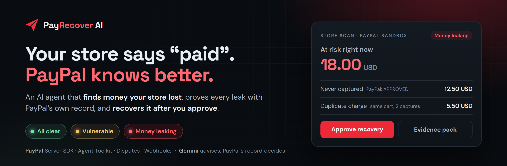
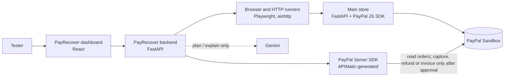

# PayRecover AI

**An AI agent for PayPal merchants: it finds money a store has lost, proves each leak, and shows how to get it back.**

Built for the PayPal AI Hackathon. It extends an earlier open-source project of mine, a website and API testing tool, with PayPal-specific checks and recovery.

A store's "Payment complete" page can be wrong. The store can say an order is paid while PayPal never captured the money, charge less than the catalog price, or charge one cart twice. PayRecover checks each claim against something it can trust: **PayPal's own record of the order**, read through PayPal's official Server SDK and Agent Toolkit. Gemini explains every result in plain words, but it never decides a result, and no money moves until the merchant approves.


---

## For judges

- **Run it yourself:** `python scripts/payrecover.py` sets everything up on the first run and starts the dashboard
  at http://127.0.0.1:8000 (needs Python 3.12+ and Node.js 22+; no keys needed for the samples). See
  [Quick start (local)](#quick-start-local).
- **No Sandbox to hand?** Under **Check payments → One order**, the sample buttons run made-up orders through the
  same checks (never captured, fake paid, wrong amount, duplicate charge, an expiring held payment, waiting for PayPal,
  healthy), and **Disputes → Show a sample dispute** shows the defender. Samples are labelled and cannot be approved.
- **A three-minute tour:**
  1. **Overview:** the three demo stores side by side, 🟢 Main (all clear), 🟠 Risky (vulnerable, no money lost),
     🔴 Vulnerable (money leaking), with money at risk and money recovered.
  2. **Check payments → Scan store** on the Vulnerable store: leaks ranked by urgency, each with PayPal's record.
     Press **Approve** on one; PayRecover captures, refunds or invoices at PayPal and confirms it with a fresh read.
  3. **Ask PayRecover:** *"How much am I losing and what should I fix first?"* Gemini answers by calling PayPal's
     Agent Toolkit and PayRecover's checks; every tool call is listed under the answer.
  4. **Disputes:** each PayPal dispute linked to its store order, with a recommended answer and a draft to approve.
  5. **Market price check** (Channel3) and the **Timeline** (Bryntum) under the scan results.

---

## What it does

1. **Finds the leak.** Scans every recent order a store calls paid and compares it with PayPal: never captured, fake paid, wrong amount, duplicate charge, and payments PayPal took that the store never recorded.
2. **Proves it.** Each leak comes with both records side by side and a printable, fingerprinted evidence pack.
3. **Recovers the money.** After the merchant approves, PayRecover captures the missed payment, refunds the duplicate or invoices the shortfall, then confirms the result with a fresh read of PayPal.
4. **Defends disputes.** Reads PayPal disputes, re-checks the disputed order, and drafts an answer (send evidence or accept the claim) for the merchant to approve.
5. **Checks the store itself.** A security and website scan catches holes that could let money leak later.

| Area | What PayRecover checks |
|---|---|
| **PayPal payments** | Reads the order straight from the PayPal Sandbox Orders API: does it exist, is it `COMPLETED`, was it **captured**, and do the order and capture amounts match what the store should have charged? |
| **AI (Gemini)** | Explains a finished order investigation or scan in plain words, writes recovery plans and dispute drafts, and answers questions in a chat that calls PayPal's Agent Toolkit. It never changes a result. |
| **Website** | HTTP status, security headers, reflected XSS, price tampering, cookies, exposed files, accessibility (axe-core), console errors, links, scripted user flows, and screenshots on failure |
| **API** | Status, response time, content type, JSON assertions, JSON Schema, and OpenAPI contract tests (Schemathesis) |
| **History** | Saved runs, side-by-side comparison (fixed / regressed), and self-contained HTML reports |

### The Main store

`main-store/` is the PayPal Sandbox checkout PayRecover checks, built to pass every check: it prices carts on
the server and ignores any price the browser sends, marks an order paid only after PayPal captures it,
sends a strict Content-Security-Policy and the other security headers, documents every response code in
its OpenAPI schema, saves orders so they survive a restart, and lets each cart be paid only once.

### The Vulnerable store

`vuln-store/` (port 8200) is a deliberately broken copy for demos, kept apart so the Main store stays clean.
Tick the bugs to simulate on its page, pay, and investigate the order in PayRecover with **Store: Vulnerable**:

| Bug on the page | What PayRecover reports |
|---|---|
| Charge the price the browser sends (prices are editable) | **Wrong amount** leak, and the price-tampering probe fails |
| Show "paid" without capturing at PayPal | **Fake paid** or **Never captured** leak |
| Let the same cart be paid multiple times | **Duplicate charge** leak, naming the other order to refund |
| List the mug at 1.25 instead of 12.50 (a price typo) | **Likely typo** in the market price check (Channel3); payments still match PayPal, so only the market comparison sees it |
| Charge the buyer, then lose the payment (store never records it) | **Payment the store never recorded**, from PayPal's side of the scan and from the payment webhook |
| Only hold the payment at PayPal and never collect it (authorize without capture) | **Held, never collected** leak, with a countdown to when PayPal gives the money back; Approve captures the hold |
| Always on: search box echoes `?q=` unescaped, no security headers | **XSS found**, and the security-headers check fails |

### The Risky store

The same store code run with `VULN_STORE_PROFILE=risky` (port 8300, `vuln-store/risky.env`): every payment bug is
locked off, so its payments always match PayPal, but its website keeps the XSS search box and sends no security
headers. Scanning it gives the middle result, 🟠 **no money leaking, but vulnerable**, so all three scan results
can be shown side by side: Main 🟢, Risky 🟠, Vulnerable with a bug on 🔴.

### Scan my store

One click checks every recent order the store calls paid (up to 50) against PayPal. Leaks are ranked by
urgency, then amount: an approved payment still uncollected comes first, with a live *waiting since* clock
taken from PayPal's own timestamp (PayPal does not publish a fixed deadline for capturing an approved order,
so PayRecover shows how long it has waited rather than inventing a countdown). Gemini writes the recovery plan
for that fixed order; it cannot add, drop or reorder leaks. A cart charged twice yields one refund, of the
later charge, so approving every row never refunds the whole purchase. The scan reads past unpaid orders
(abandoned checkouts, cancelled price probes) so the newest paid orders are always the ones checked.

### Market price check (Channel3)

A mistyped price is paid in full, so PayPal's records match and no payment check can see it, yet it loses money on
every sale. **Check prices against the market** (under Check payments → Whole store, or *"Are any of my prices
wrong?"* in the chat) searches [Channel3](https://trychannel3.com) (100M+ products from 25,000+ retailers) for
comparable new, in-stock products, takes each product's cheapest US offer, and compares the store's price with the
market median: under a third of it is a **likely typo**, over three times is **overpriced**. Each result shows the
market range and example retailers. Each store product carries a plain `market` description ("ceramic coffee mug
11 oz") so the search finds comparable products. Searches are cached for six hours. Set `TESTPILOT_CHANNEL3_API_KEY`
(free for hackathon participants at trychannel3.com/developers).

### Timeline (Bryntum Scheduler)

A [Bryntum Scheduler](https://bryntum.com/products/scheduler/) timeline with one row per store plus PayPal disputes,
from three days back to ten days ahead: every scan as a block coloured by its result, every recovery, and every open
dispute as a bar from the day it opened to PayPal's response deadline, red when fewer than three days are left.
Hover a block for details. It uses Bryntum's trial package (`@bryntum/scheduler-trial`, aliased to
`@bryntum/scheduler`), which shows a trial watermark; Bryntum's install scripts are not needed and are not run.
The timeline loads in its own chunk, so the rest of the dashboard opens fast.

### Overview and auto-scan

The dashboard opens with four headline numbers (orders scanned, money at risk, open PayPal disputes, money
recovered) and a strip with each demo store's latest result: 🟢 all clear, 🟠 vulnerable, 🔴 money leaking, or not
scanned yet. Click a store to scan it now. After a recovery, the store's payments are re-checked in the background
so money at risk drops right away.

**Auto-scan**, switched on and off in the top bar, scans every store every 5, 10, 30 or 60 minutes while the server
runs, even with the dashboard closed, and keeps the setting across restarts. It skips the AI plan (no AI calls),
and alerts only when a store's result changes, so the same alert is not sent every few minutes. A manual scan
always alerts.

### Ask PayRecover (Gemini + PayPal's Agent Toolkit)

A chat on the dashboard: ask *"How much am I losing and what should I fix first?"* or *"Do I have disputes?"*.
Gemini plans the steps and calls the tools itself, and every call is listed under its answer:

- **PayPal's [Agent Toolkit](https://github.com/paypal/agent-toolkit)**: PayPal's own AI tools for reading
  orders, disputes, transactions and invoices. Only read-only tools are offered to the model.
- **PayRecover's checks**: scan the store, investigate an order, list disputes with evidence, find
  unrecorded payments, list recoveries.
- **Proposals, never actions**: to collect, refund, invoice or answer a dispute, the model can only call
  `propose_recovery` or `propose_dispute_answer`. Each proposal appears as an **Approve** button that runs the
  same approved, verified path as the dashboard. A proposal for a leak that does not exist is refused.

### Use PayRecover from any AI assistant (MCP)

PayRecover is also an [MCP](https://modelcontextprotocol.io) server, so Claude, ChatGPT or any agent framework can use
the same tools as the dashboard's assistant: `scan_store`, `investigate_order`, `find_unrecorded_payments`,
`list_dispute_cases`, `list_recoveries`, `check_market_prices`, `propose_recovery`, `check_paypal_setup` and
`run_demo_scenario`. It is served at `POST /api/mcp` (Streamable HTTP, one JSON reply per request) behind the same API
token and rate limit. An outside assistant can never move money: `propose_recovery` returns what would happen and
where the merchant approves (a signed approval link when `TESTPILOT_APPROVAL_SECRET` is set).

```bash
claude mcp add --transport http payrecover http://127.0.0.1:8000/api/mcp
```

For a hosted deployment, add `--header "Authorization: Bearer <your API token>"` and use its `https://` address.

### Dispute defender (PayPal Disputes)

The **Disputes** panel reads your PayPal disputes with the Agent Toolkit, follows each disputed capture to its
order and store (stores tag their payments with a `custom_id`), and re-runs that order's checks. Gemini then
recommends an answer, **send evidence** or **accept the claim**, with a draft message to PayPal built only
from those facts; rules take over if the AI is unavailable or picks an action PayPal does not offer for that
dispute. You edit the message and approve. PayRecover re-reads the dispute first (only actions PayPal still
offers are allowed), sends it (evidence via `provide-evidence`, or the toolkit's `accept_dispute_claim`), and
confirms the change with a fresh read. A duplicate charge PayRecover already found is a reason to accept;
a paid order with matching PayPal records is a reason to send evidence.

To try it, sign in to [sandbox.paypal.com](https://www.sandbox.paypal.com) as the Sandbox buyer, open a payment
and report a problem. Turn on **Disputes** under your app's Features if PayPal refuses to list them.

### Payments the store never recorded (PayPal's side)

The store scan starts from the store's orders; PayRecover also starts from **PayPal's transaction list**
(Transaction Search, read with the Agent Toolkit) and reports completed payments carrying the store's tag that
the store has no paid order for. The buyer was charged and nothing will ship, which is how disputes start.
Refunded payments are left out and buyer emails are masked. Turn on **Transaction search** under your app's
Features; PayPal's list can lag new payments by up to three hours.

### Real-time: PayPal webhooks

`POST /api/paypal/webhook` receives PayPal events once `TESTPILOT_PAYPAL_WEBHOOK_ID` is set (create the webhook
in your app on developer.paypal.com, pointing at your public URL). Every event is verified with PayPal's
`verify-webhook-signature` before it is read. `PAYMENT.CAPTURE.COMPLETED` re-checks that order in its store and
alerts through Zapier on a leak or an unrecorded payment; `CUSTOMER.DISPUTE.CREATED` sends the dispute with the
AI's recommended answer. Webhooks only start checks and alerts; money still moves only after approval.
Webhooks need a public address, so they work once deployed (for example on Render), not on localhost.

### AI-written buyer messages

When PayRecover invoices a buyer for a short payment, Gemini writes a short, polite note for the invoice; the
facts line (order and balance due) is always added by PayRecover, and the invoice is sent without a note from
the model if the AI is unavailable.

### Dispute-ready evidence pack

Every investigation and scan row has an **Evidence pack**: a printable page, generated from a fresh read of
the store and PayPal, with both records side by side, every check, the leaks, every recovery and its PayPal
references, and a SHA-256 fingerprint of that evidence. Print it to PDF and attach it to a PayPal dispute or
chargeback.

### Built on PayPal's Server SDK (APIMatic)

PayRecover reads orders, captures missed payments and refunds duplicate charges through
[PayPal's official Python Server SDK](https://github.com/paypal/PayPal-Python-Server-SDK) (`paypal-server-sdk`),
which PayPal generates with [APIMatic](https://www.apimatic.io/). The SDK is locked to Sandbox in
`backend/app/paypal_sdk.py` and returns PayPal's JSON unchanged, so every check works on PayPal's own record.
Invoicing is not part of the SDK yet, so invoices still use PayPal's Invoicing REST API directly.

### PayRecover's own SDK and API portal (APIMatic)

PayRecover's OpenAPI description is exported to [`docs/openapi.json`](docs/openapi.json): clean operation names
(`scan_store`, `investigate_order`, `approve_recovery`, `list_recoveries`, `evidence_pack`), a server address and the
optional bearer-token login. It passes APIMatic's validation with no errors (SDK generation readiness 100/100).
From it, [APIMatic](https://www.apimatic.io/) generates PayRecover SDKs for Python, TypeScript and C#, and an API
portal with the reference, SDK guides and a getting-started page, so a store or another AI agent can scan and
recover in a few lines:

```python
from pay_recover_ai_api import PayRecoverAiApiClient

with PayRecoverAiApiClient(base_url="http://127.0.0.1:8000") as client:
    scan = client.pay_recover.scan_store({"store": "main", "limit": 25})
    print(f"{scan.leaking_orders} leaking orders, {scan.money_at_risk} {scan.currency} at risk")

    for item in scan.items:
        for leak in item.leaks:
            # Only after the merchant approves; the leak is recomputed and verified against PayPal.
            record = client.pay_recover.approve_recovery(
                {"order_id": item.order_id, "store": "main", "kind": leak.kind, "approved": True}
            )
            print(record.status, record.message)
```

To build the SDKs and portal yourself (Node.js 24+):

```bash
npm install -g @apimatic/cli@2
apimatic quickstart                # in an empty folder; give it docs/openapi.json
apimatic sdk generate -l python    # or typescript / csharp
apimatic portal generate           # static portal files you can host
```

After changing an endpoint, run `backend\.venv\Scripts\python scripts\export_openapi.py`; a test fails while the
committed file is out of date.

### Recovering the money

Every leak comes with a recovery the merchant can approve, on the dashboard or from a Zapier message:

| Leak | Recovery at PayPal (Sandbox) | Confirmed when |
|---|---|---|
| Never captured | Capture the approved order | PayPal shows a COMPLETED capture for the full amount |
| Wrong amount, fake paid | Send the buyer a PayPal invoice for the missing amount | PayPal shows the invoice SENT for that amount |
| Duplicate charge | Refund the extra capture | PayPal shows the refund COMPLETED or PENDING |

The **Money recovered** panel (AG Grid) lists every recovery with totals collected, invoiced and refunded.
Invoicing needs the *Invoicing* feature switched on for your Sandbox app (Apps & Credentials > your app > Features).

### Alerts: dashboard, email and Zapier

Every scan ends with one of three results. The scan also runs a store-wide security check once (price tampering,
reflected XSS, security headers), so a store can be judged even when no money has leaked yet:

| Result | When | Alert |
|---|---|---|
| 🔴 **Money leaking** | At least one payment does not match PayPal | Sent at once, with the amounts, approve links, and the holes that let it happen |
| 🟠 **No leak, but vulnerable** | Every payment matches PayPal, but the store has a hole that could let money leak | Sent at once, with what to fix |
| 🟢 **All clear** | Payments match PayPal and the store passes the security checks | Shown on the dashboard only; nothing is sent |

An order investigation follows the same rule: red for a leak, orange when its probes find a hole.

PayRecover tells the merchant when money leaks, a payment goes unrecorded, a dispute opens or a recovery
finishes, in three layers set in the dashboard's **Alerts** card:

1. **The alert feed on the dashboard**: always on, no setup.
2. **Email**: type an address once; PayRecover sends the alert itself through [Brevo](https://www.brevo.com)
   (free plan). The server needs `TESTPILOT_BREVO_API_KEY` and a Brevo-verified sender in `TESTPILOT_ALERT_SENDER`.
3. **Zapier (optional)**: paste your own Zapier *Catch Hook* to forward alerts to Slack, SMS, a Google Sheet or any
   of 9,000+ apps. Without one, the operator's `TESTPILOT_ZAPIER_WEBHOOK_URL` is used if set. Only
   `hooks.zapier.com` addresses are accepted.

Each user's settings and feed are kept apart, **Send test alert** checks the setup (five an hour), and a failing
channel is shown on the alert and never fails a scan or recovery. With `TESTPILOT_APPROVAL_SECRET` (32+ random
characters) set, every leak alert carries a signed **Approve recovery** link that expires after 24 hours.
Opening it only shows a confirmation page; money moves when the button on it is pressed.

### Catching payment bugs

For every order, PayRecover compares the store's claim with PayPal's record and reports these leaks:

| Leak | What PayRecover sees |
|---|---|
| Never captured | The store says `PAID`; PayPal says `APPROVED` with no capture |
| Fake paid | The store says `PAID`; PayPal never received a payment |
| Wrong amount | PayPal charged less than the catalog total (the server trusted a browser price) |
| Duplicate charge | Another order for the same cart was also captured (or one order captured twice) |
| Held, never collected | The store says `PAID`; PayPal only holds the money (intent `AUTHORIZE`) and nobody captured it. "Act now" within three days of the hold's expiry |
| Hold expired | The hold ran out before it was captured, so PayPal gave the money back; PayRecover invoices the buyer instead |

When nothing is wrong but a check could not finish (PayPal still holds a disputed payment, or its transaction list
could not be read), a scan says **waiting for PayPal** instead of all clear, and lists what is missing.

The **PayPal setup** line on the dashboard asks PayPal which features your Sandbox app allows (Transaction search,
Disputes, Invoicing, webhooks) and names exactly where to switch on any that are off.

---

## Built during the hackathon

PayRecover started from an earlier open-source project of mine, a website and API testing tool. Before the
Submission Period (which opened on 1 October 2026) it had the SSRF-safe browser and HTTP runners, the accessibility
and security-header checks, JSON Schema and OpenAPI contract tests, saved run history, run comparison and HTML reports.

Everything PayPal- and money-related was built during the hackathon, from late October 2026 (see the commit history):

- **PayPal checks:** the Main, Vulnerable and Risky Sandbox stores, order investigation against PayPal's Orders API
  through PayPal's official Server SDK, duplicate-charge detection, and the price-tampering and reflected-XSS probes.
- **Whole-store scan:** every recent paid order checked, leaks ranked by urgency, the three-colour result
  (money leaking, vulnerable, all clear) and the dispute-ready evidence pack.
- **Recovery:** capture, refund or invoice after the merchant approves, confirmed by a fresh read of PayPal, logged in
  the AG Grid **Money recovered** panel.
- **AI with PayPal's Agent Toolkit:** the Ask PayRecover chat, the dispute defender, payments PayPal took that the store
  never recorded (Transaction Search), and AI-written recovery plans and buyer notes.
- **Real time:** verified PayPal webhooks, alerts by dashboard, email (Brevo) and Zapier, signed approval links,
  and auto-scan.
- **Sponsor integrations:** Channel3 market price check, Bryntum timeline, APIMatic-ready OpenAPI and SDKs, and the
  Render blueprint.

## PayPal, AI and tools used

| Tool | How PayRecover uses it |
|---|---|
| **PayPal Server SDK** (`paypal-server-sdk`, APIMatic-generated) | Reads orders, captures approved payments and refunds duplicate charges in the Sandbox |
| **PayPal Agent Toolkit** | Read-only tools for the Gemini chat; lists disputes and transactions; accepts dispute claims |
| **PayPal REST APIs** | Invoicing (short payments), Disputes (`provide-evidence`), Transaction Search, webhook signature verification |
| **PayPal JS SDK** | The checkout buttons in the three demo stores |
| **Google Gemini** | Plans the chat's tool calls, explains results, words recovery plans, dispute drafts and buyer notes. Advisory only: it never decides a result or moves money |
| **Channel3** | Market prices for each product, to catch price typos PayPal's records cannot reveal |
| **Bryntum Scheduler** | The timeline of scans, recoveries and dispute deadlines per store |
| **AG Grid** | The Money recovered log and the scan results grid |
| **APIMatic** | Generates PayPal's Server SDK, and PayRecover's own SDKs and API portal from `docs/openapi.json` |
| **Zapier, Brevo** | Alert delivery to any app, and by email |
| **Render** | Hosting, from the included `render.yaml` blueprint |

---

## How it works



1. A buyer pays in the **Main store** with a PayPal Sandbox account. The store prices the cart on its server, creates the PayPal order, and captures it after approval.
2. The store records what it **believes** happened (`GET /api/orders/{id}`).
3. PayRecover asks **PayPal** what actually happened (`POST /api/paypal/verify`) and compares the two, check by check, with evidence.

### Design principles

- **Evidence decides, AI advises.** Runners and PayPal's API produce every status; Gemini's output is labelled advisory, with the model that wrote it.
- **Sandbox only.** The PayPal API address is hard-coded to `api-m.sandbox.paypal.com`. No setting can point PayRecover at live payments.
- **Nothing moves without approval.** Investigating only reads PayPal. A capture, refund or invoice runs only when the merchant approves it, is recalculated from PayPal at that moment, runs once (PayPal-Request-Id), and counts only when a fresh read of PayPal confirms it. Browser runs allow GET/HEAD requests only.
- **No personal data in evidence.** Payer and payee details are never copied into results.
- **SSRF-safe.** Every target address is validated and the connection pinned to it, and the browser cannot open connections of its own. See [docs/threat-model.md](docs/threat-model.md).

---

## Quick start (local)

**You need:** Python 3.12+ and Node.js 22+. PayPal and Gemini keys are optional.

### 1. Run one command

```bash
python scripts/payrecover.py
```

The first run sets everything up (a few minutes, once): a Python environment in `backend/.venv` with every
package, the Chromium browser the website checks use, and the built dashboard. Then it starts all four parts
and prints the addresses. Later runs start straight away. Press **Ctrl+C** to stop everything.

| Open | What |
|---|---|
| http://127.0.0.1:8000 | **PayRecover dashboard** |
| http://127.0.0.1:8100 | Main store |
| http://127.0.0.1:8200 | Vulnerable store (demo bugs) |
| http://127.0.0.1:8300 | Risky store (correct payments, insecure website) |
| http://127.0.0.1:8000/docs | API docs |

On macOS or Linux use `python3` if `python` is an older version. If those ports are busy, add `--port 9000`
(the stores then use 9100, 9200 and 9300).

### 2. See it work without any keys (two minutes)

- **Check payments → One order (deep check)**: press any sample button (*Never captured*, *Duplicate charge*,
  *Held payment expiring*, ...). Each runs made-up orders through the same checks as real ones.
- **Disputes → Show a sample dispute**: the dispute defender's evidence and recommended answer.
- The dashboard's **PayPal setup** line says which keys are missing and where to get them.

### 3. Add keys for live PayPal Sandbox checks (optional)

The first run created `backend/.env` and `main-store/.env` from their examples. Fill in your Sandbox **Client ID**
and **Secret** in both (the Vulnerable and Risky stores reuse `main-store/.env`), then restart. Full steps,
including a fix for developer accounts registered in India, are in [docs/paypal-sandbox.md](docs/paypal-sandbox.md).

For Gemini, set `TESTPILOT_GOOGLE_API_KEY` (from [Google AI Studio](https://aistudio.google.com)) in `backend/.env`.
`TESTPILOT_AI_MODEL` picks the model (default `gemini-3.8-flash`), `TESTPILOT_AI_FALLBACK_MODELS` lists backups
tried when it is busy, and `TESTPILOT_AI_DAILY_LIMIT` (default 300, 0 for none) caps AI requests per UTC day.
Without a key, every feature uses its built-in, rule-based answer. Environment variables keep the `TESTPILOT_`
prefix from the project's earlier name.

Then try a real payment:

1. In the **Main store**, click **PayPal** and pay with your Sandbox *Personal* (buyer) account.
2. In the dashboard, **Check payments → Whole store → Scan store**: every paid order should match PayPal.
3. For a failing case, tick a bug in the **Vulnerable store**, pay there, and scan the Vulnerable store.
   Press **Approve** on a leak to recover it.

### Working on the code

`python scripts/payrecover.py setup` updates the environment after a `git pull`. For live-reloading development,
run the backend with `uvicorn app.main:app --reload` from `backend/` and the dashboard with `npm run dev` from
`frontend/` (http://127.0.0.1:5173, which forwards `/api` to the backend); tests and linters need
`pip install -r backend/requirements-dev.txt`.

---

## Project layout

```
backend/      FastAPI API: runners, PayPal verifier, order investigation, AI adapter, storage, security
frontend/     React dashboard (Vite)
main-store/   The PayPal Sandbox checkout PayRecover checks, built to pass every check
vuln-store/   A deliberately vulnerable copy with switchable payment bugs, for demos only
demo-site/    Static pages published to GitHub Pages as a public website-test target
docs/         Setup, API contract, deployment, threat model and design decisions
scripts/      Local start and validation helpers
```

## Tests

```bash
cd backend; .\.venv\Scripts\python -m unittest discover -s tests
```

```bash
cd main-store; ..\backend\.venv\Scripts\python -m unittest discover -s tests
```

```bash
cd vuln-store; ..\backend\.venv\Scripts\python -m unittest discover -s tests
```

```bash
cd frontend; npm run lint; npm test
```

GitHub Actions runs the backend, main-store, vuln-store and frontend tests and a Docker build on every push.

## Deployment

The PayRecover backend and dashboard ship as a single Docker image (`docker compose up --build`). A Render blueprint (`render.yaml`) is included. Public deployments refuse to start unless authentication, rate limiting, audit logging and HTTPS are configured. See [docs/deployment.md](docs/deployment.md).

## Roadmap

- [x] PayPal Sandbox checkout in the Main store
- [x] Independent payment verification against the PayPal Orders API
- [x] Dashboard panel for payment verification
- [x] One order id runs every check: store claim, PayPal record, price probe, website scan
- [x] Gemini explanations with retries and fallback models
- [x] Verified PayPal webhooks (signature checked before any event is read)
- [x] Dispute defender, scan, recovery and evidence pack
- [x] Market price check (Channel3), timeline (Bryntum) and auto-scan
- [ ] Hosted demo on Render (blueprint ready in `render.yaml`)
- [ ] Next: automated checkout scenarios (success and cancellation). These need a write-enabled browser mode, kept
      apart from today's read-only runners on purpose.

## Documentation

- [PayPal Sandbox setup](docs/paypal-sandbox.md)
- [API contract](docs/api-contract.md)
- [Deployment](docs/deployment.md)
- [Threat model](docs/threat-model.md)
- [Design decisions](docs/decisions.md)

## License

[MIT](LICENSE). The vendored axe-core is MPL-2.0 (`backend/app/vendor/`).
