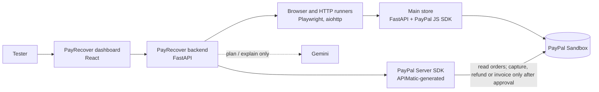

# PayRecover AI

**An AI agent for PayPal merchants: it finds money a store has lost, proves each leak, and shows how to get it back.**

Built for the PayPal AI Hackathon. It extends an earlier open-source project of mine, a website and API testing tool, with PayPal-specific checks and recovery.

A store's "Payment complete" page can be wrong. The store can say an order is paid while PayPal never captured the money, charge less than the catalog price, or charge one cart twice. PayRecover checks each claim against something it can trust: **PayPal's own record of the order**, read through PayPal's official Server SDK and Agent Toolkit. Gemini explains every result in plain words, but it never decides a result, and no money moves until the merchant approves.


---

## What it does

1. **Finds the leak.** Scans every recent order a store calls paid and compares it with PayPal: never captured, fake paid, wrong amount, duplicate charge, and payments PayPal took that the store never recorded.
2. **Proves it.** Each leak comes with both records side by side and a printable, fingerprinted evidence pack.
3. **Recovers the money.** After the merchant approves, PayRecover captures the missed payment, refunds the duplicate or invoices the shortfall, then confirms the result with a fresh read of PayPal.
4. **Defends disputes.** Reads PayPal disputes, re-checks the disputed order, and drafts an answer (send evidence or accept the claim) for the merchant to approve.
5. **Checks the store itself.** A security and website scan catches holes that could let money leak later.

| Area | What PayRecover checks |
|---|---|
| **PayPal payments** | Reads the order straight from the PayPal Sandbox Orders API: does it exist, is it `COMPLETED`, was it **captured**, and do the order and capture amounts match what the store should have charged? |
| **AI (Gemini)** | Explains a finished order investigation or scan in plain words, writes recovery plans and dispute drafts, and answers questions in a chat that calls PayPal's Agent Toolkit. It never changes a result. |
| **Website** | HTTP status, security headers, reflected XSS, price tampering, cookies, exposed files, accessibility (axe-core), console errors, links, scripted user flows, and screenshots on failure |
| **API** | Status, response time, content type, JSON assertions, JSON Schema, and OpenAPI contract tests (Schemathesis) |
| **History** | Saved runs, side-by-side comparison (fixed / regressed), and self-contained HTML reports |

### The Main store

`main-store/` is the PayPal Sandbox checkout PayRecover checks, built to pass every check: it prices carts on
the server and ignores any price the browser sends, marks an order paid only after PayPal captures it,
sends a strict Content-Security-Policy and the other security headers, documents every response code in
its OpenAPI schema, saves orders so they survive a restart, and lets each cart be paid only once.

### The Vulnerable store

`vuln-store/` (port 8200) is a deliberately broken copy for demos, kept apart so the Main store stays clean.
Tick the bugs to simulate on its page, pay, and investigate the order in PayRecover with **Store: Vulnerable**:

| Bug on the page | What PayRecover reports |
|---|---|
| Charge the price the browser sends (prices are editable) | **Wrong amount** leak, and the price-tampering probe fails |
| Show "paid" without capturing at PayPal | **Fake paid** or **Never captured** leak |
| Let the same cart be paid multiple times | **Duplicate charge** leak, naming the other order to refund |
| Charge the buyer, then lose the payment (store never records it) | **Payment the store never recorded**, from PayPal's side of the scan and from the payment webhook |
| Always on: search box echoes `?q=` unescaped, no security headers | **XSS found**, and the security-headers check fails |

### The Risky store

The same store code run with `VULN_STORE_PROFILE=risky` (port 8300, `vuln-store/risky.env`): every payment bug is
locked off, so its payments always match PayPal, but its website keeps the XSS search box and sends no security
headers. Scanning it gives the middle result, 🟠 **no money leaking, but vulnerable**, so all three scan results
can be shown side by side: Main 🟢, Risky 🟠, Vulnerable with a bug on 🔴.

### Scan my store

One click checks every recent order the store calls paid (up to 50) against PayPal. Leaks are ranked by
urgency, then amount: an approved payment still uncollected comes first, with a live *waiting since* clock
taken from PayPal's own timestamp (PayPal does not publish a fixed deadline for capturing an approved order,
so PayRecover shows how long it has waited rather than inventing a countdown). Gemini writes the recovery plan
for that fixed order; it cannot add, drop or reorder leaks. A cart charged twice yields one refund, of the
later charge, so approving every row never refunds the whole purchase.

### Ask PayRecover (Gemini + PayPal's Agent Toolkit)

A chat on the dashboard: ask *"How much am I losing and what should I fix first?"* or *"Do I have disputes?"*.
Gemini plans the steps and calls the tools itself, and every call is listed under its answer:

- **PayPal's [Agent Toolkit](https://github.com/paypal/agent-toolkit)**: PayPal's own AI tools for reading
  orders, disputes, transactions and invoices. Only read-only tools are offered to the model.
- **PayRecover's checks**: scan the store, investigate an order, list disputes with evidence, find
  unrecorded payments, list recoveries.
- **Proposals, never actions**: to collect, refund, invoice or answer a dispute, the model can only call
  `propose_recovery` or `propose_dispute_answer`. Each proposal appears as an **Approve** button that runs the
  same approved, verified path as the dashboard. A proposal for a leak that does not exist is refused.

### Dispute defender (PayPal Disputes)

The **Disputes** panel reads your PayPal disputes with the Agent Toolkit, follows each disputed capture to its
order and store (stores tag their payments with a `custom_id`), and re-runs that order's checks. Gemini then
recommends an answer, **send evidence** or **accept the claim**, with a draft message to PayPal built only
from those facts; rules take over if the AI is unavailable or picks an action PayPal does not offer for that
dispute. You edit the message and approve. PayRecover re-reads the dispute first (only actions PayPal still
offers are allowed), sends it (evidence via `provide-evidence`, or the toolkit's `accept_dispute_claim`), and
confirms the change with a fresh read. A duplicate charge PayRecover already found is a reason to accept;
a paid order with matching PayPal records is a reason to send evidence.

To try it, sign in to [sandbox.paypal.com](https://www.sandbox.paypal.com) as the Sandbox buyer, open a payment
and report a problem. Turn on **Disputes** under your app's Features if PayPal refuses to list them.

### Payments the store never recorded (PayPal's side)

The store scan starts from the store's orders; PayRecover also starts from **PayPal's transaction list**
(Transaction Search, read with the Agent Toolkit) and reports completed payments carrying the store's tag that
the store has no paid order for. The buyer was charged and nothing will ship, which is how disputes start.
Refunded payments are left out and buyer emails are masked. Turn on **Transaction search** under your app's
Features; PayPal's list can lag new payments by up to three hours.

### Real-time: PayPal webhooks

`POST /api/paypal/webhook` receives PayPal events once `TESTPILOT_PAYPAL_WEBHOOK_ID` is set (create the webhook
in your app on developer.paypal.com, pointing at your public URL). Every event is verified with PayPal's
`verify-webhook-signature` before it is read. `PAYMENT.CAPTURE.COMPLETED` re-checks that order in its store and
alerts through Zapier on a leak or an unrecorded payment; `CUSTOMER.DISPUTE.CREATED` sends the dispute with the
AI's recommended answer. Webhooks only start checks and alerts; money still moves only after approval.
Webhooks need a public address, so they work once deployed (for example on Render), not on localhost.

### AI-written buyer messages

When PayRecover invoices a buyer for a short payment, Gemini writes a short, polite note for the invoice; the
facts line (order and balance due) is always added by PayRecover, and the invoice is sent without a note from
the model if the AI is unavailable.

### Dispute-ready evidence pack

Every investigation and scan row has an **Evidence pack**: a printable page, generated from a fresh read of
the store and PayPal, with both records side by side, every check, the leaks, every recovery and its PayPal
references, and a SHA-256 fingerprint of that evidence. Print it to PDF and attach it to a PayPal dispute or
chargeback.

### Built on PayPal's Server SDK (APIMatic)

PayRecover reads orders, captures missed payments and refunds duplicate charges through
[PayPal's official Python Server SDK](https://github.com/paypal/PayPal-Python-Server-SDK) (`paypal-server-sdk`),
which PayPal generates with [APIMatic](https://www.apimatic.io/). The SDK is locked to Sandbox in
`backend/app/paypal_sdk.py` and returns PayPal's JSON unchanged, so every check works on PayPal's own record.
Invoicing is not part of the SDK yet, so invoices still use PayPal's Invoicing REST API directly.

### PayRecover's own SDK and API portal (APIMatic)

PayRecover's OpenAPI description is exported to [`docs/openapi.json`](docs/openapi.json): clean operation names
(`scan_store`, `investigate_order`, `approve_recovery`, `list_recoveries`, `evidence_pack`), a server address and the
optional bearer-token login. It passes APIMatic's validation with no errors (SDK generation readiness 100/100).
From it, [APIMatic](https://www.apimatic.io/) generates PayRecover SDKs for Python, TypeScript and C#, and an API
portal with the reference, SDK guides and a getting-started page, so a store or another AI agent can scan and
recover in a few lines:

```python
from pay_recover_ai_api import PayRecoverAiApiClient

with PayRecoverAiApiClient(base_url="http://127.0.0.1:8000") as client:
    scan = client.pay_recover.scan_store({"store": "main", "limit": 25})
    print(f"{scan.leaking_orders} leaking orders, {scan.money_at_risk} {scan.currency} at risk")

    for item in scan.items:
        for leak in item.leaks:
            # Only after the merchant approves; the leak is recomputed and verified against PayPal.
            record = client.pay_recover.approve_recovery(
                {"order_id": item.order_id, "store": "main", "kind": leak.kind, "approved": True}
            )
            print(record.status, record.message)
```

To build the SDKs and portal yourself (Node.js 24+):

```bash
npm install -g @apimatic/cli@2
apimatic quickstart                # in an empty folder; give it docs/openapi.json
apimatic sdk generate -l python    # or typescript / csharp
apimatic portal generate           # static portal files you can host
```

After changing an endpoint, run `backend\.venv\Scripts\python scripts\export_openapi.py`; a test fails while the
committed file is out of date.

### Recovering the money

Every leak comes with a recovery the merchant can approve, on the dashboard or from a Zapier message:

| Leak | Recovery at PayPal (Sandbox) | Confirmed when |
|---|---|---|
| Never captured | Capture the approved order | PayPal shows a COMPLETED capture for the full amount |
| Wrong amount, fake paid | Send the buyer a PayPal invoice for the missing amount | PayPal shows the invoice SENT for that amount |
| Duplicate charge | Refund the extra capture | PayPal shows the refund COMPLETED or PENDING |

The **Money recovered** panel (AG Grid) lists every recovery with totals collected, invoiced and refunded.
Invoicing needs the *Invoicing* feature switched on for your Sandbox app (Apps & Credentials > your app > Features).

### Alerts: dashboard, email and Zapier

Every scan ends with one of three results. The scan also runs a store-wide security check once (price tampering,
reflected XSS, security headers), so a store can be judged even when no money has leaked yet:

| Result | When | Alert |
|---|---|---|
| 🔴 **Money leaking** | At least one payment does not match PayPal | Sent at once, with the amounts, approve links, and the holes that let it happen |
| 🟠 **No leak, but vulnerable** | Every payment matches PayPal, but the store has a hole that could let money leak | Sent at once, with what to fix |
| 🟢 **All clear** | Payments match PayPal and the store passes the security checks | Shown on the dashboard only; nothing is sent |

An order investigation follows the same rule: red for a leak, orange when its probes find a hole.

PayRecover tells the merchant when money leaks, a payment goes unrecorded, a dispute opens or a recovery
finishes, in three layers set in the dashboard's **Alerts** card:

1. **The alert feed on the dashboard**: always on, no setup.
2. **Email**: type an address once; PayRecover sends the alert itself through [Brevo](https://www.brevo.com)
   (free plan). The server needs `TESTPILOT_BREVO_API_KEY` and a Brevo-verified sender in `TESTPILOT_ALERT_SENDER`.
3. **Zapier (optional)**: paste your own Zapier *Catch Hook* to forward alerts to Slack, SMS, a Google Sheet or any
   of 9,000+ apps. Without one, the operator's `TESTPILOT_ZAPIER_WEBHOOK_URL` is used if set. Only
   `hooks.zapier.com` addresses are accepted.

Each user's settings and feed are kept apart, **Send test alert** checks the setup (five an hour), and a failing
channel is shown on the alert and never fails a scan or recovery. With `TESTPILOT_APPROVAL_SECRET` (32+ random
characters) set, every leak alert carries a signed **Approve recovery** link that expires after 24 hours.
Opening it only shows a confirmation page; money moves when the button on it is pressed.

### Catching payment bugs

For every order, PayRecover compares the store's claim with PayPal's record and reports these leaks:

| Leak | What PayRecover sees |
|---|---|
| Never captured | The store says `PAID`; PayPal says `APPROVED` with no capture |
| Fake paid | The store says `PAID`; PayPal never received a payment |
| Wrong amount | PayPal charged less than the catalog total (the server trusted a browser price) |
| Duplicate charge | Another order for the same cart was also captured (or one order captured twice) |

---

## How it works



1. A buyer pays in the **Main store** with a PayPal Sandbox account. The store prices the cart on its server, creates the PayPal order, and captures it after approval.
2. The store records what it **believes** happened (`GET /api/orders/{id}`).
3. PayRecover asks **PayPal** what actually happened (`POST /api/paypal/verify`) and compares the two, check by check, with evidence.

### Design principles

- **Evidence decides, AI advises.** Runners and PayPal's API produce every status; Gemini's output is labelled advisory, with the model that wrote it.
- **Sandbox only.** The PayPal API address is hard-coded to `api-m.sandbox.paypal.com`. No setting can point PayRecover at live payments.
- **Nothing moves without approval.** Investigating only reads PayPal. A capture, refund or invoice runs only when the merchant approves it, is recalculated from PayPal at that moment, runs once (PayPal-Request-Id), and counts only when a fresh read of PayPal confirms it. Browser runs allow GET/HEAD requests only.
- **No personal data in evidence.** Payer and payee details are never copied into results.
- **SSRF-safe.** Every target address is validated and the connection pinned to it, and the browser cannot open connections of its own. See [docs/threat-model.md](docs/threat-model.md).

---

## Quick start (local)

**Requirements:** Python 3.12+, Node.js 22+, and a free [PayPal Developer](https://developer.paypal.com) account.

### 1. Install

```bash
cd backend
python -m venv .venv
.venv\Scripts\pip install -r requirements-dev.txt
.venv\Scripts\pip install --no-deps -r requirements-toolkit.txt
.venv\Scripts\python -m playwright install chromium
.venv\Scripts\pip install -r ..\main-store\requirements.txt
.venv\Scripts\pip install -r ..\vuln-store\requirements.txt
cd ..\frontend
npm ci
```

On macOS or Linux, use `.venv/bin/` instead of `.venv\Scripts\`.

### 2. Add PayPal Sandbox keys

Copy `backend/.env.example` to `backend/.env`, and `main-store/.env.example` to `main-store/.env`, then fill in your Sandbox **Client ID** and **Secret**. Full steps, including a fix for developer accounts registered in India, are in [docs/paypal-sandbox.md](docs/paypal-sandbox.md).

Environment variables keep the `TESTPILOT_` prefix from the project's earlier name; it is only a prefix and is not shown to users.

Optionally, set `TESTPILOT_GOOGLE_API_KEY` (from [Google AI Studio](https://aistudio.google.com)) and `TESTPILOT_AI_MODEL` (default `gemini-3.8-flash`) in `backend/.env` to turn on Gemini. `TESTPILOT_AI_FALLBACK_MODELS` lists backup models (lighter Flash-Lite models work well) tried when the main one is busy. Everything else works without it.

The Vulnerable store reuses `main-store/.env`, so it needs no keys of its own.

### 3. Run (four terminals; the Vulnerable store is optional)

```bash
cd backend; .\.venv\Scripts\python -m uvicorn app.main:app --port 8000
```

```bash
cd main-store; ..\backend\.venv\Scripts\python -m uvicorn store_app:app --port 8100
```

```bash
cd vuln-store; ..\backend\.venv\Scripts\python -m uvicorn store_app:app --port 8200
```

Optional, the Risky store (correct payments, insecure website):

```bash
cd vuln-store; ..\backend\.venv\Scripts\python -m uvicorn store_app:app --port 8300 --env-file risky.env
```

```bash
cd frontend; npm run dev
```

| Open | What |
|---|---|
| http://127.0.0.1:5173 | PayRecover dashboard |
| http://127.0.0.1:8100 | Main store |
| http://127.0.0.1:8200 | Vulnerable store (demo bugs) |
| http://127.0.0.1:8000/docs | Backend API docs |

### 4. Try it

1. In the **Main store**, click **PayPal** and pay with your Sandbox *Personal* (buyer) account.
2. Copy the **Order** id the store shows.
3. In the **dashboard**, open **Investigate order**, keep **Store: Main**, paste the id and click **Run all checks**.
4. Every check should pass: **Healthy, 0.00 USD at risk**, no XSS, and the store's website checks green.
5. For a failing case, tick a bug in the **Vulnerable store**, pay there, and investigate with **Store: Vulnerable**.

---

## Project layout

```
backend/      FastAPI API: runners, PayPal verifier, order investigation, AI adapter, storage, security
frontend/     React dashboard (Vite)
main-store/   The PayPal Sandbox checkout PayRecover checks, built to pass every check
vuln-store/   A deliberately vulnerable copy with switchable payment bugs, for demos only
demo-site/    Static pages published to GitHub Pages as a public website-test target
docs/         Setup, API contract, deployment, threat model and design decisions
scripts/      Local start and validation helpers
```

## Tests

```bash
cd backend; .\.venv\Scripts\python -m unittest discover -s tests
```

```bash
cd main-store; ..\backend\.venv\Scripts\python -m unittest discover -s tests
```

```bash
cd vuln-store; ..\backend\.venv\Scripts\python -m unittest discover -s tests
```

```bash
cd frontend; npm run lint; npm test
```

GitHub Actions runs the backend, main-store, vuln-store and frontend tests and a Docker build on every push.

## Deployment

The PayRecover backend and dashboard ship as a single Docker image (`docker compose up --build`). A Render blueprint (`render.yaml`) is included. Public deployments refuse to start unless authentication, rate limiting, audit logging and HTTPS are configured. See [docs/deployment.md](docs/deployment.md).

## Roadmap

- [x] PayPal Sandbox checkout in the Main store
- [x] Independent payment verification against the PayPal Orders API
- [x] Dashboard panel for payment verification
- [ ] Playwright checkout scenarios (success and cancellation) driven from the dashboard
- [x] One order id runs every check: store claim, PayPal record, price probe, website scan
- [x] Gemini explanations with retries and fallback models
- [x] Verified PayPal webhooks (signature checked before any event is read)
- [x] Dispute defender, scan, recovery and evidence pack
- [ ] Hosted demo (Render) and remote browser sessions (Kernel)

## Documentation

- [PayPal Sandbox setup](docs/paypal-sandbox.md)
- [API contract](docs/api-contract.md)
- [Deployment](docs/deployment.md)
- [Threat model](docs/threat-model.md)
- [Design decisions](docs/decisions.md)

## License

[MIT](LICENSE). The vendored axe-core is MPL-2.0 (`backend/app/vendor/`).
