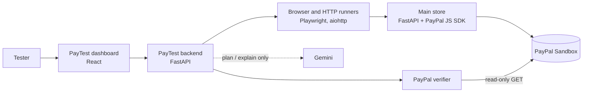

# PayTest AI

**An AI-assisted testing agent that checks e-commerce checkouts and PayPal payments, and backs every verdict with evidence.**

Built for the PayPal AI Hackathon on top of TestPilot AI, an open-source website and API testing tool.

A store's "Payment complete" page can be wrong. A browser test can pass while the money was never collected, and an AI can say a payment worked when it didn't. PayTest checks each claim against something it can trust: real browser and HTTP runners, and **PayPal's own record of the order**. The AI plans tests and explains results, but it never decides a result.


---

## What it does

| Area | What PayTest checks |
|---|---|
| **PayPal payments** | Reads the order straight from the PayPal Sandbox Orders API: does it exist, is it `COMPLETED`, was it **captured**, and do the order and capture amounts match what the store should have charged? |
| **Website** | HTTP status, title, headings, console errors, links, security headers, cookies, exposed files, accessibility (axe-core), keyboard focus, response time, scripted user flows (fill, click, expect text), and screenshots on failure |
| **API** | Status, response time, content type, redirects, size, JSON assertions, JSON Schema, response shape, and OpenAPI contract tests (Schemathesis) |
| **AI (Gemini)** | Turns a plain-English goal into a test plan you review before it runs, and explains a finished report or order investigation in plain words. It never changes a result. |
| **History** | Saved runs, side-by-side comparison (fixed / regressed), and self-contained HTML reports |

### The Main store

`main-store/` is the PayPal Sandbox checkout PayTest checks, built to pass every check: it prices carts on
the server and ignores any price the browser sends, marks an order paid only after PayPal captures it,
sends a strict Content-Security-Policy and the other security headers, documents every response code in
its OpenAPI schema, saves orders so they survive a restart, and lets each cart be paid only once.

### The Vulnerable store

`vuln-store/` (port 8200) is a deliberately broken copy for demos, kept apart so the Main store stays clean.
Tick the bugs to simulate on its page, pay, and investigate the order in PayTest with **Store: Vulnerable**:

| Bug on the page | What PayTest reports |
|---|---|
| Charge the price the browser sends (prices are editable) | **Wrong amount** leak, and the price-tampering probe fails |
| Show "paid" without capturing at PayPal | **Fake paid** or **Never captured** leak |
| Let the same cart be paid more than once | **Duplicate charge** leak, naming the other order to refund |
| Always on: search box echoes `?q=` unescaped, no security headers | **XSS found**, and the security-headers check fails |

### Catching payment bugs

For every order, PayRecover compares the store's claim with PayPal's record and reports these leaks:

| Leak | What PayTest sees |
|---|---|
| Never captured | The store says `PAID`; PayPal says `APPROVED` with no capture |
| Fake paid | The store says `PAID`; PayPal never received a payment |
| Wrong amount | PayPal charged less than the catalog total (the server trusted a browser price) |
| Duplicate charge | Another order for the same cart was also captured (or one order captured twice) |

---

## How it works



1. A buyer pays in the **Main store** with a PayPal Sandbox account. The store prices the cart on its server, creates the PayPal order, and captures it after approval.
2. The store records what it **believes** happened (`GET /api/orders/{id}`).
3. PayTest asks **PayPal** what actually happened (`POST /api/paypal/verify`) and compares the two, check by check, with evidence.

### Design principles

- **Evidence decides, AI advises.** Runners and PayPal's API produce every status; Gemini's output is labelled advisory, with the model that wrote it.
- **Sandbox only.** The PayPal API address is hard-coded to `api-m.sandbox.paypal.com`. No setting can point PayTest at live payments.
- **Read-only.** The verifier only reads orders. Browser runs allow GET/HEAD requests only, and the API runner sends a single GET.
- **No personal data in evidence.** Payer and payee details are never copied into results.
- **SSRF-safe.** Every target address is validated and the connection pinned to it, and the browser cannot open connections of its own. See [docs/threat-model.md](docs/threat-model.md).

---

## Quick start (local)

**Requirements:** Python 3.12+, Node.js 22+, and a free [PayPal Developer](https://developer.paypal.com) account.

### 1. Install

```bash
cd backend
python -m venv .venv
.venv\Scripts\pip install -r requirements-dev.txt
.venv\Scripts\python -m playwright install chromium
.venv\Scripts\pip install -r ..\main-store\requirements.txt
.venv\Scripts\pip install -r ..\vuln-store\requirements.txt
cd ..\frontend
npm ci
```

On macOS or Linux, use `.venv/bin/` instead of `.venv\Scripts\`.

### 2. Add PayPal Sandbox keys

Copy `backend/.env.example` to `backend/.env`, and `main-store/.env.example` to `main-store/.env`, then fill in your Sandbox **Client ID** and **Secret**. Full steps, including a fix for developer accounts registered in India, are in [docs/paypal-sandbox.md](docs/paypal-sandbox.md).

Optionally, set `TESTPILOT_GOOGLE_API_KEY` (from [Google AI Studio](https://aistudio.google.com)) and `TESTPILOT_AI_MODEL` (default `gemini-3.8-flash`) in `backend/.env` to turn on Gemini. `TESTPILOT_AI_FALLBACK_MODELS` lists backup models (lighter Flash-Lite models work well) tried when the main one is busy. Everything else works without it.

The Vulnerable store reuses `main-store/.env`, so it needs no keys of its own.

### 3. Run (four terminals; the Vulnerable store is optional)

```bash
cd backend; .\.venv\Scripts\python -m uvicorn app.main:app --port 8000
```

```bash
cd main-store; ..\backend\.venv\Scripts\python -m uvicorn store_app:app --port 8100
```

```bash
cd vuln-store; ..\backend\.venv\Scripts\python -m uvicorn store_app:app --port 8200
```

```bash
cd frontend; npm run dev
```

| Open | What |
|---|---|
| http://127.0.0.1:5173 | PayTest dashboard |
| http://127.0.0.1:8100 | Main store |
| http://127.0.0.1:8200 | Vulnerable store (demo bugs) |
| http://127.0.0.1:8000/docs | Backend API docs |

### 4. Try it

1. In the **Main store**, click **PayPal** and pay with your Sandbox *Personal* (buyer) account.
2. Copy the **Order** id the store shows.
3. In the **dashboard**, open **Investigate order**, keep **Store: Main**, paste the id and click **Run all checks**.
4. Every check should pass: **Healthy, 0.00 USD at risk**, no XSS, and the store's website checks green.
5. For a failing case, tick a bug in the **Vulnerable store**, pay there, and investigate with **Store: Vulnerable**.

---

## Project layout

```
backend/      FastAPI API: runners, PayPal verifier, order investigation, AI adapter, storage, security
frontend/     React dashboard (Vite)
main-store/   The PayPal Sandbox checkout PayTest checks, built to pass every check
vuln-store/   A deliberately vulnerable copy with switchable payment bugs, for demos only
demo-site/    Static pages published to GitHub Pages as a public website-test target
docs/         Setup, API contract, deployment, threat model and design decisions
scripts/      Local start and validation helpers
```

## Tests

```bash
cd backend; .\.venv\Scripts\python -m unittest discover -s tests
```

```bash
cd main-store; ..\backend\.venv\Scripts\python -m unittest discover -s tests
```

```bash
cd vuln-store; ..\backend\.venv\Scripts\python -m unittest discover -s tests
```

```bash
cd frontend; npm run lint; npm test
```

GitHub Actions runs the backend, main-store, vuln-store and frontend tests and a Docker build on every push.

## Deployment

The PayTest backend and dashboard ship as a single Docker image (`docker compose up --build`). A Render blueprint (`render.yaml`) is included. Public deployments refuse to start unless authentication, rate limiting, audit logging and HTTPS are configured. See [docs/deployment.md](docs/deployment.md).

## Roadmap

- [x] PayPal Sandbox checkout in the Main store
- [x] Independent payment verification against the PayPal Orders API
- [x] Dashboard panel for payment verification
- [ ] Playwright checkout scenarios (success and cancellation) driven from the dashboard
- [x] One order id runs every check: store claim, PayPal record, price probe, website scan
- [x] Gemini explanations with retries and fallback models
- [ ] Webhook signature verification check
- [ ] Hosted demo (Render) and remote browser sessions (Kernel)

## Documentation

- [PayPal Sandbox setup](docs/paypal-sandbox.md)
- [API contract](docs/api-contract.md)
- [Deployment](docs/deployment.md)
- [Threat model](docs/threat-model.md)
- [Design decisions](docs/decisions.md)

## License

[MIT](LICENSE). The vendored axe-core is MPL-2.0 (`backend/app/vendor/`).
